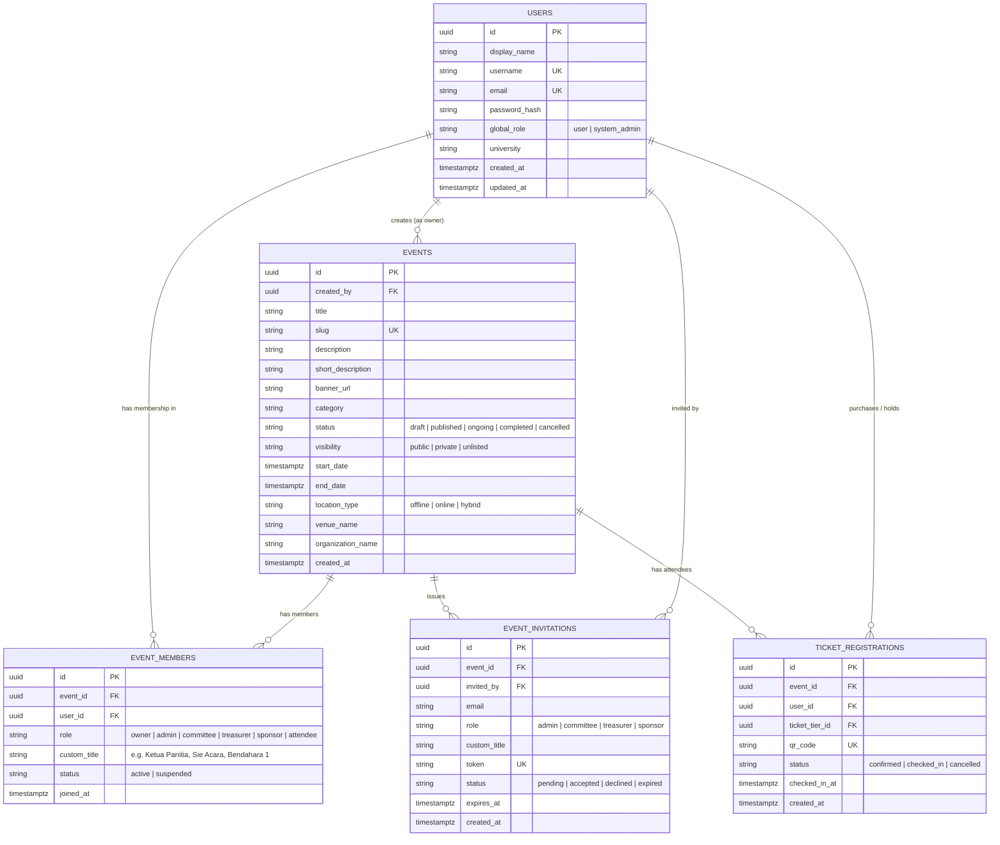
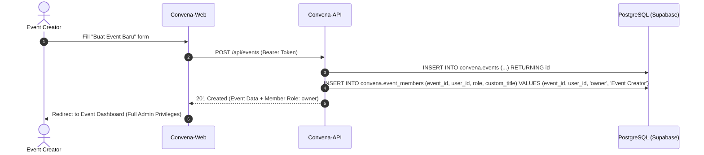
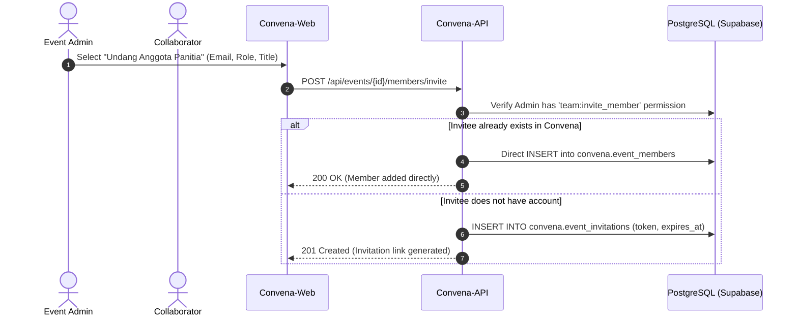

# Convena Architecture & RBAC Design Document

## 1. Architectural Philosophy: Global Identity vs. Contextual (Event-Scoped) RBAC

In Convena, an account represents a **Global User Identity**, not a static system-wide operational role. 

Operational roles (such as `admin`, `committee`, `treasurer`, `sponsor`, `attendee`) **do not exist at the account level**. Instead, all roles are **Contextual and Scoped to an Event**.

### Why Account-Level Roles Are Anti-Patterns in Multi-Event Platforms:
- If a user chooses "Attendee" during registration, they would be barred from creating or managing an event later without admin intervention.
- In reality, university students and organizers switch hats across events:
  - **Project A (e.g. Arkavidia Festival)**:
    - **Arya**: `admin` / `owner` (Ketua Pelaksana)
    - **Michelle**: `committee` (Sie Acara)
    - **Tesa**: `attendee` (Ticket holder)
  - **Project B (e.g. National Hackathon)**:
    - **Tesa**: `admin` / `owner` (Project Lead)
    - **Arya**: `committee` (Technical Staff)
    - **Michelle**: `attendee` (Contestant)

### Global vs. Scoped Separation:
1. **Global Scope (`convena.users`)**:
   - Manages identity, authentication, profile (Name, Username, Email, Password Hash, University, Avatar).
   - Global role defaults to `'user'` (only platform operators hold `'system_admin'`).
2. **Event Scope (`convena.event_members`)**:
   - Manages role, permissions, and responsibilities for that specific event.
   - Every registered user can create an event. The creator is automatically granted the `owner` role for that event.
   - Event owners and admins can invite collaborators and assign event-scoped roles.

---

## 2. Entity-Relationship (ER) Model



---

## 3. Event Role Hierarchy & Granular Permission Matrix

The platform uses a role-based permission evaluation engine. Operations in the backend check the user's role against the required `EventPermission`.

```
Owner
  └── Admin
        ├── Committee
        ├── Treasurer (Finance Focus)
        └── Sponsor Rep (Read-Only Deliverables)
```

| Permission Scope | Owner | Admin | Committee | Treasurer | Sponsor Rep | Attendee |
| :--- | :---: | :---: | :---: | :---: | :---: | :---: |
| `event:edit_settings` | ✅ | ✅ | ❌ | ❌ | ❌ | ❌ |
| `event:delete` | ✅ | ❌ | ❌ | ❌ | ❌ | ❌ |
| `team:invite_member` | ✅ | ✅ | ❌ | ❌ | ❌ | ❌ |
| `team:manage_roles` | ✅ | ✅ | ❌ | ❌ | ❌ | ❌ |
| `team:view_members` | ✅ | ✅ | ✅ | ✅ | ❌ | ❌ |
| `tickets:manage_tiers` | ✅ | ✅ | ❌ | ❌ | ❌ | ❌ |
| `tickets:scan_checkin` | ✅ | ✅ | ✅ | ❌ | ❌ | ❌ |
| `finance:view_budget` | ✅ | ✅ | ✅ | ✅ | ❌ | ❌ |
| `finance:submit_spj` | ✅ | ✅ | ✅ | ✅ | ❌ | ❌ |
| `finance:audit_spj` | ✅ | ✅ | ❌ | ✅ | ❌ | ❌ |
| `sponsorship:manage` | ✅ | ✅ | ✅ | ❌ | ❌ | ❌ |
| `sponsorship:deliverables` | ✅ | ✅ | ✅ | ❌ | ✅ | ❌ |
| `certificate:issue` | ✅ | ✅ | ✅ | ❌ | ❌ | ❌ |
| `attendee:view_own_ticket` | ✅ | ✅ | ✅ | ✅ | ✅ | ✅ |

---

## 4. Lifecycle Flows

### 4.1 Account Registration
1. User provides `display_name`, `username`, `email`, and `password`.
2. Backend validates uniqueness, hashes password with Argon2 (id-argon2id), and inserts into `convena.users` with `global_role = 'user'`.
3. User is returned a JWT Bearer token containing their `user_id` and `email`.

### 4.2 Event Creation & Auto-Ownership


### 4.3 Inviting Team Members


---

## 5. Security & Authorization Architecture

### Backend (Rust / Axum):
1. **JWT Authentication Layer**:
   - Validates Bearer token on incoming HTTP requests.
   - Extracts `user_id` and attaches `CurrentUser` to request extensions.
2. **Event Authorization Guard**:
   - Reads `event_id` from URL path parameter (e.g. `/api/events/:event_id/...`).
   - Queries `convena.event_members` for `(event_id, user_id)`.
   - Compares the member's `role` against required permission matrix.
   - If unauthorized, rejects immediately with `403 Forbidden` (`INSUFFICIENT_EVENT_PERMISSIONS`).

### Frontend (React / Tailwind):
1. **Auth Context**: Stores authenticated user identity.
2. **Hook `useEventAuth(eventId)`**:
   - Queries current user's membership for the event.
   - Exposes boolean permission helpers: `canEditSettings`, `canAuditSpj`, `canScanTickets`, `isOwner`, `isAdmin`, `isCommittee`, `isTreasurer`.
3. **UI Permission Gates**:
   - Sensitive action buttons (e.g. "Verifikasi Kuitansi", "Edit Informasi Event", "Undang Tim") conditionally render based on `useEventAuth`.
