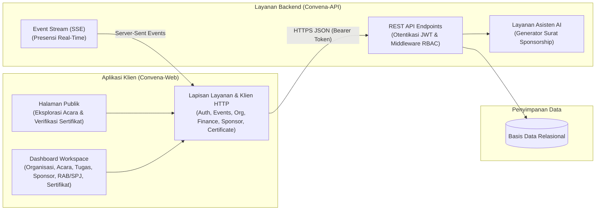
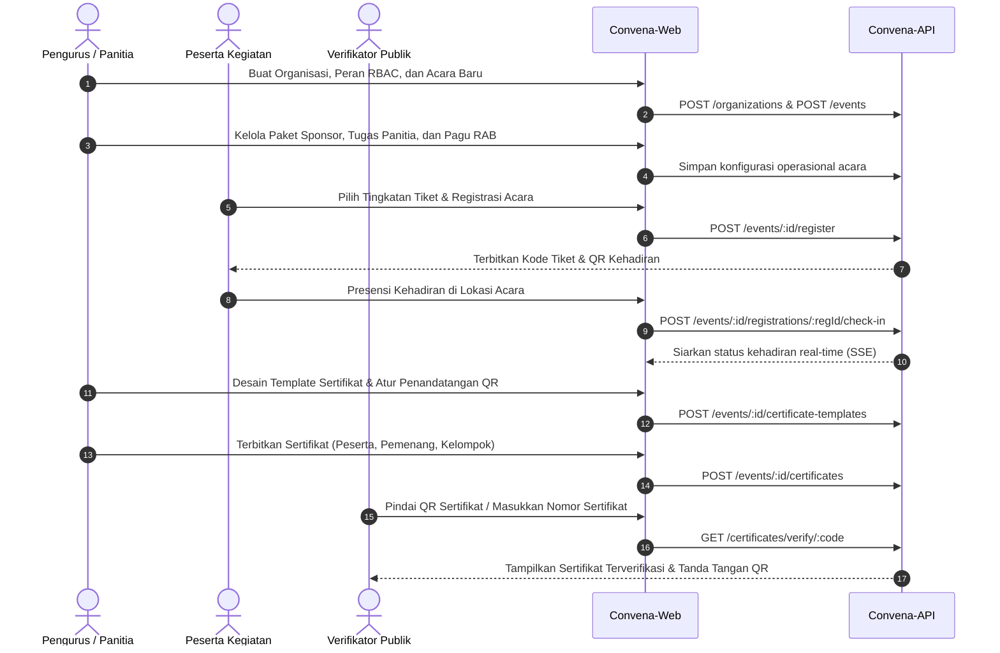
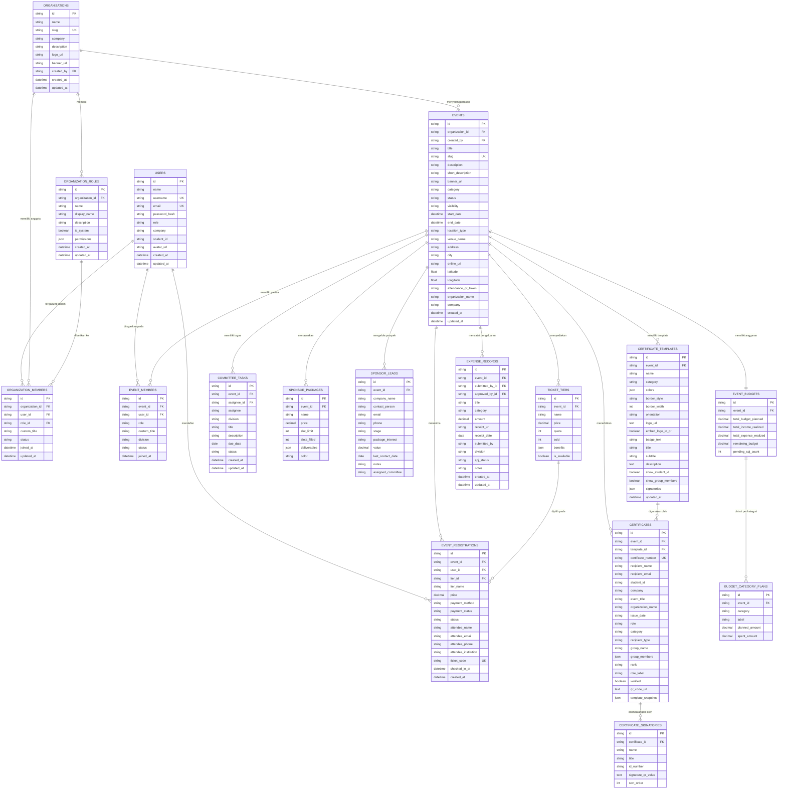

# Convena-Web

Convena-Web adalah aplikasi web manajemen kegiatan dan operasional organisasi kemahasiswaan (Ormawa, BEM, Himpunan Mahasiswa, dan Unit Kegiatan Mahasiswa) di Indonesia. Platform ini mengintegrasikan siklus penuh penyelenggaraan acara kampus mulai dari pengelolaan organisasi berbasis peran (Role-Based Access Control), publikasi acara, registrasi peserta, presensi kehadiran berbasis kode QR secara waktu nyata (real-time), manajemen tugas kepanitiaan, pengelolaan pipeline sponsorship berbantuan kecerdasan buatan (AI), pencatatan anggaran Rencana Anggaran Biaya (RAB) dan Surat Pertanggungjawaban (SPJ), hingga studio desain serta penerbitan dan verifikasi e-sertifikat resmi.

---

## Daftar Isi

1. [Gambaran Umum dan Tujuan Proyek](#gambaran-umum-dan-tujuan-proyek)
2. [Fitur Utama](#fitur-utama)
3. [Teknologi yang Digunakan](#teknologi-yang-digunakan)
4. [Arsitektur Sistem dan Alur Kerja](#arsitektur-sistem-dan-alur-kerja)
5. [Struktur Basis Data (ERD)](#struktur-basis-data-erd)
6. [Sistem Hak Akses dan Peran (RBAC)](#sistem-hak-akses-dan-peran-rbac)
7. [Panduan Instalasi dan Persiapan Lingkungan](#panduan-instalasi-dan-persiapan-lingkungan)
8. [Daftar Rute Aplikasi](#daftar-rute-aplikasi)
9. [Spesifikasi Endpoint API Utama](#spesifikasi-endpoint-api-utama)

---

## Gambaran Umum dan Tujuan Proyek

Penyelenggaraan kegiatan kemahasiswaan umumnya menggunakan berbagai perangkat terpisah untuk pendaftaran peserta, koordinasi panitia, pelacakan sponsor, rekapitulasi nota pengeluaran (SPJ), serta pembuatan sertifikat. Pemisahan ini sering menyebabkan duplikasi data, keterlambatan penyusunan Laporan Pertanggungjawaban (LPJ), serta sulitnya memvalidasi keaslian sertifikat kepanitiaan maupun peserta.

Convena hadir sebagai satu ruang kerja terpadu (single workspace) yang menghubungkan seluruh kebutuhan operasional tersebut ke dalam basis data yang terstruktur, transparan, dan dapat diaudit oleh pengurus organisasi maupun pihak kampus.

---

## Fitur Utama

### 1. Manajemen Organisasi dan Hak Akses (RBAC)
- Pembuatan dan pengelolaan profil organisasi kemahasiswaan beserta identitas universitas atau institusi.
- Pengelolaan peran kustom (Role) dengan matriks izin granular untuk modul organisasi, acara, tugas, sponsorship, keuangan, dan sertifikasi.
- Undang anggota baru melalui alamat surel atau nama pengguna serta penugasan jabatan kustom (custom title) dan divisi.

### 2. Manajemen Acara, Tiket, dan Peta Lokasi Interaktif
- Pembuatan acara dengan kategori Seminar, Workshop, Kompetisi, Festival, Konferensi, dan Gathering.
- Dukungan mode pelaksanaan luring (offline), daring (online), maupun hibrida (hybrid) lengkap dengan pemilih titik koordinat GPS interaktif berbasis Leaflet dan OpenStreetMap.
- Pengaturan kuota dan tingkatan tiket (Ticket Tiers) gratis maupun berbayar.
- Halaman eksplorasi publik dengan filter kategori, kampus, status acara, dan pencarian kata kunci.

### 3. Presensi Kehadiran QR Real-Time
- Pembuatan token QR kehadiran unik untuk setiap acara.
- Pemindaian tiket peserta dan sinkronisasi status kehadiran (`checked_in`) secara langsung melalui Server-Sent Events (SSE), BroadcastChannel, dan pemutakhiran otomatis.

### 4. Manajemen Tugas Kepanitiaan (Task Management)
- Pendistribusian tugas per divisi kepanitiaan lengkap dengan tenggat waktu, penanggung jawab (PIC), dan pelacakan status (`todo`, `in_progress`, `completed`).

### 5. Pipeline Sponsorship dan Asisten Draf Proposal AI
- Pelacakan prospek sponsor melalui tahapan pipeline (`prospect`, `contacted`, `proposal_sent`, `negotiating`, `committed`, `paid`, `rejected`).
- Pengelolaan kuota paket sponsor (Platinum, Gold, Silver) dan daftar kewajiban kontraprestasi (deliverables).
- Generator draf surat penawaran kerja sama sponsorship otomatis menggunakan integrasi layanan AI dengan opsi gaya bahasa formal maupun hangat.

### 6. Manajemen Anggaran (RAB) dan Verifikasi Kuitansi SPJ
- Pemantauan pagu anggaran terencana terhadap realisasi pengeluaran aktual pada setiap kategori biaya (`equipment`, `catering`, `venue`, `marketing`, `speaker_honor`, `logistics`, `other`).
- Pencatatan nota pengeluaran oleh panitia beserta alur persetujuan dan audit verifikasi SPJ oleh bendahara atau pengurus inti (`draft`, `submitted`, `verified`, `rejected`).

### 7. Studio Desain, Penerbitan, dan Verifikasi E-Sertifikat
- Setiap template dan sertifikat yang diterbitkan terikat secara spesifik pada satu acara (`eventId`).
- Kustomisasi visual template secara langsung (live preview) meliputi skema warna, tipe bingkai (`rounded`, `flat`, `double`, `ornate`, `minimal`, `none`), ketebalan garis, orientasi kertas (`landscape` dan `portrait`), serta variabel narasi dinamis (`{{nama}}`, `{{event}}`, `{{peran}}`, `{{peringkat}}`, `{{tim}}`, `{{anggota}}`, `{{instansi}}`, `{{tanggal}}`, `{{nomor}}`).
- Penyematan logo institusi (mendukung format Base64) pada tajuk sertifikat sekaligus di bagian tengah Kode QR Validasi Utama dengan tingkat koreksi kesalahan tinggi (`level="H"`).
- Pengaturan jumlah dan jabatan penandatangan secara dinamis (Ketua Pelaksana, Rektor, Wakil Rektor, Dekan, Ketua Dewan Juri, Ketua Himpunan, dan lainnya) di mana seluruh tanda tangan dirender sebagai Kode QR digital murni tanpa gambar tanda tangan basah di dalamnya.
- Dukungan variasi sertifikat untuk pemenang kompetisi (`winner`), peserta (`attendance`), kelompok atau tim beserta daftar anggota (`group`), pembicara (`speaker`), dan panitia (`committee`).
- Ekspor cetak dan penyimpanan dokumen PDF berkualitas vektor serta halaman verifikasi publik berdasarkan nomor sertifikat atau pemindaian QR.

---

## Teknologi yang Digunakan

| Kategori | Teknologi | Versi / Keterangan |
| :--- | :--- | :--- |
| Pustaka Antarmuka | React | 19.3.x |
| Bahasa Pemrograman | TypeScript | 6.0.x |
| Build Tool & Bundler | Vite | 8.3.x (dengan React Compiler) |
| Framework Styling | Tailwind CSS | 4.3.x (`@tailwindcss/vite`) |
| Routing | React Router DOM | 7.18.x |
| Peta & Geospasial | Leaflet | 1.9.x |
| Generator Kode QR | `qrcode.react` & `react-qr-code` | Render SVG dan Canvas dengan tingkat koreksi kesalahan |
| Ikonografi | Lucide React | 1.61.x |
| Linter | Oxlint | 1.88.x |

---

## Arsitektur Sistem dan Alur Kerja

Aplikasi web Convena-Web berkomunikasi dengan layanan backend Convena REST API melalui klien HTTP terpusat yang menangani otorisasi token Bearer JWT, serialisasi JSON, serta aliran data kehadiran waktu nyata.



### Alur Operasional End-to-End Penyelenggaraan Acara



---

## Struktur Basis Data (ERD)

Diagram berikut merepresentasikan struktur entitas dan relasi data utama yang digunakan oleh ekosistem Convena:



---

## Sistem Hak Akses dan Peran (RBAC)

Convena menerapkan pengendalian akses dua tingkat, yaitu tingkat organisasi (`OrgRole`) dan tingkat kepanitiaan acara (`EventRole`).

| Hak Akses / Kemampuan | Owner | Admin | Treasurer (Bendahara) | Committee (Panitia) | Sponsor | Attendee (Peserta) |
| :--- | :---: | :---: | :---: | :---: | :---: | :---: |
| Mengelola Pengaturan & Menghapus Acara | Ya | Sebagian | Tidak | Tidak | Tidak | Tidak |
| Mengelola Anggota Tim & Peran | Ya | Ya | Tidak | Tidak | Tidak | Tidak |
| Memindai QR Kehadiran Peserta | Ya | Ya | Tidak | Ya | Tidak | Tidak |
| Melihat Rencana Anggaran (RAB) | Ya | Ya | Ya | Ya | Tidak | Tidak |
| Mengajukan Kuitansi Pengeluaran (SPJ) | Ya | Ya | Ya | Ya | Tidak | Tidak |
| Memverifikasi & Menyetujui Audit SPJ | Ya | Ya | Ya | Tidak | Tidak | Tidak |
| Mengelola Pipeline Sponsorship | Ya | Ya | Tidak | Ya | Tidak | Tidak |
| Melihat Kontraprestasi Sponsor | Ya | Ya | Tidak | Ya | Ya | Tidak |
| Mendesain & Menerbitkan E-Sertifikat | Ya | Ya | Tidak | Ya | Tidak | Tidak |
| Memverifikasi Keaslian Sertifikat | Ya | Ya | Ya | Ya | Ya | Ya |

---

## Panduan Instalasi dan Persiapan Lingkungan

### Prasyarat Sistem
- **Node.js**: Versi 20.x atau lebih baru (direkomendasikan versi LTS terbaru).
- **Package Manager**: `npm` (bawaan Node.js).
- **Layanan Backend**: Server Convena-API yang berjalan pada lingkungan lokal atau server produksi.

### Langkah Instalasi

1. **Kloning Repositori**
   ```bash
   git clone <url-repositori-convena-web>
   cd Convena-Web
   ```

2. **Instalasi Dependensi**
   ```bash
   npm install
   ```

3. **Konfigurasi Variabel Lingkungan (Environment Variables)**
   Buat berkas `.env` pada direktori utama proyek apabila ingin mengarahkan aplikasi ke URL backend tertentu:
   ```env
   VITE_API_URL=http://localhost:8000
   ```
   Apabila variabel `VITE_API_URL` tidak diatur, aplikasi secara otomatis menggunakan:
   - Mode Pengembangan (`npm run dev`): `http://localhost:8000`
   - Mode Produksi (`npm run build`): `https://env-opentask.user.cloudjkt02.com/api/convena`

4. **Menjalankan Server Pengembangan**
   ```bash
   npm run dev
   ```
   Aplikasi dapat diakses melalui peramban pada alamat `http://localhost:5173`.

### Daftar Perintah Skrip

| Perintah | Deskripsi |
| :--- | :--- |
| `npm run dev` | Menjalankan server pengembangan Vite dengan fitur Hot Module Replacement (HMR). |
| `npm run lint` | Menjalankan pemeriksaan kualitas kode statis menggunakan Oxlint. |
| `npm run build` | Melakukan pemeriksaan tipe TypeScript (`tsc -b`) dan membangun bundel produksi ke direktori `dist`. |
| `npm run preview` | Menjalankan pratinjau hasil kompilasi produksi secara lokal. |

---

## Daftar Rute Aplikasi

### Rute Publik (`MainLayout`)
- `/` : Halaman beranda utama Convena.
- `/events` : Katalog eksplorasi dan pencarian acara mahasiswa.
- `/events/:id` : Halaman detail informasi acara, peta lokasi, dan pendaftaran tiket.
- `/verify` : Halaman publik pemeriksaan dan validasi keaslian e-sertifikat.
- `/verify/:code` : Halaman verifikasi langsung berdasarkan nomor sertifikat atau tautan pindaian kode QR.
- `/login` : Halaman masuk pengguna.
- `/register` : Halaman pendaftaran akun baru.

### Rute Ruang Kerja Pengurus (`DashboardLayout`)
- `/dashboard` : Ringkasan metrik utama dan ikhtisar ruang kerja.
- `/dashboard/organization` : Manajemen profil organisasi, peran RBAC, izin akses, dan daftar anggota.
- `/dashboard/events` : Daftar acara yang dikelola, pemindaian QR kehadiran, dan daftar pendaftar.
- `/dashboard/events/create` : Formulir pembuatan acara baru.
- `/dashboard/events/:id/edit` : Formulir penyuntingan data acara.
- `/dashboard/tasks` : Papan manajemen tugas divisi kepanitiaan.
- `/dashboard/sponsorship` : Manajemen prospek sponsor, paket sponsorship, dan asisten draf email AI.
- `/dashboard/finances` : Pengelolaan pagu anggaran RAB, pelacakan varians biaya, dan tabel verifikasi kuitansi SPJ.
- `/dashboard/certificate` : Studio desain template e-sertifikat, pengaturan tanda tangan QR, variasi penerima, dan penerbitan sertifikat.
- `/dashboard/verify` : Halaman validasi sertifikat di dalam ruang kerja internal.

---

## Spesifikasi Endpoint API Utama

Berikut adalah ringkasan endpoint REST API yang digunakan oleh layanan frontend Convena-Web:

### Otentikasi dan Pengguna
- `POST /auth/login` : Otentikasi pengguna dengan email atau username dan kata sandi.
- `POST /auth/register` : Registrasi pengguna baru.
- `GET /auth/me` : Mengambil profil pengguna yang sedang masuk beserta sesi aktif.

### Organisasi dan RBAC
- `GET /organizations` : Mengambil daftar organisasi milik pengguna.
- `POST /organizations` : Membuat organisasi baru.
- `GET /organizations/:id/roles` : Mengambil daftar peran dan izin akses dalam organisasi.
- `POST /organizations/:id/roles` : Membuat peran kustom baru beserta daftar izin (`permissions`).
- `GET /organizations/:id/members` : Mengambil daftar anggota organisasi.
- `POST /organizations/:id/members` : Mengundang anggota baru ke dalam organisasi.

### Acara, Registrasi, dan Presensi
- `GET /events` : Mengambil daftar seluruh acara publik.
- `GET /events/my-events` : Mengambil daftar acara yang dikelola oleh pengguna.
- `POST /events` : Membuat acara baru.
- `PATCH /events/:id` : Memperbarui informasi acara.
- `POST /events/:id/register` : Mendaftarkan peserta pada tingkatan tiket tertentu.
- `GET /events/:id/registrations` : Mengambil daftar peserta terdaftar pada suatu acara.
- `POST /events/:id/attendance-qr` : Menghasilkan token QR presensi kehadiran acara.
- `POST /events/attend` : Memproses presensi kehadiran peserta menggunakan kode QR.
- `POST /events/:id/registrations/:regId/check-in` : Melakukan verifikasi kehadiran manual atau melalui pemindaian oleh panitia.
- `GET /events/:id/attendance-stream` : Kanal SSE untuk pemutakhiran data presensi secara waktu nyata.

### Tugas, Sponsorship, dan Keuangan
- `GET /events/:id/tasks` & `POST /events/:id/tasks` : Mengambil dan membuat tugas kepanitiaan.
- `GET /sponsorship/packages` & `GET /sponsorship/leads` : Mengambil paket dan prospek sponsor.
- `PATCH /sponsorship/leads/:id` : Memperbarui tahapan pipeline prospek sponsor.
- `POST /ai/generate-proposal-email` : Menghasilkan draf surat penawaran sponsorship dengan bantuan LLM.
- `GET /finances/summary/:eventId` : Mengambil ringkasan anggaran RAB dan realisasi pengeluaran acara.
- `PATCH /finances/summary/:eventId/category` : Memperbarui pagu anggaran per kategori pengeluaran.
- `GET /finances/expenses/:eventId` & `POST /finances/expenses/:eventId` : Mengambil dan mencatat kuitansi pengeluaran SPJ.
- `PATCH /finances/expenses/:eventId/:expenseId/verify` : Menyetujui atau menolak kuitansi SPJ.

### E-Sertifikat dan Verifikasi
- `GET /events/:eventId/certificate-templates` : Mengambil daftar template sertifikat untuk acara terkait.
- `POST /events/:eventId/certificate-templates` : Menyimpan template desain sertifikat baru pada acara.
- `PUT /events/:eventId/certificate-templates/:templateId` : Memperbarui template desain sertifikat.
- `GET /events/:eventId/certificates` : Mengambil daftar sertifikat yang telah diterbitkan pada acara.
- `POST /events/:eventId/certificates` : Menerbitkan sertifikat untuk daftar penerima (peserta, pemenang, kelompok, pembicara, atau panitia).
- `DELETE /events/:eventId/certificates/:certificateId` : Mencabut sertifikat yang telah diterbitkan.
- `GET /certificates/verify/:code` : Memverifikasi keaslian sertifikat berdasarkan kode nomor sertifikat.
